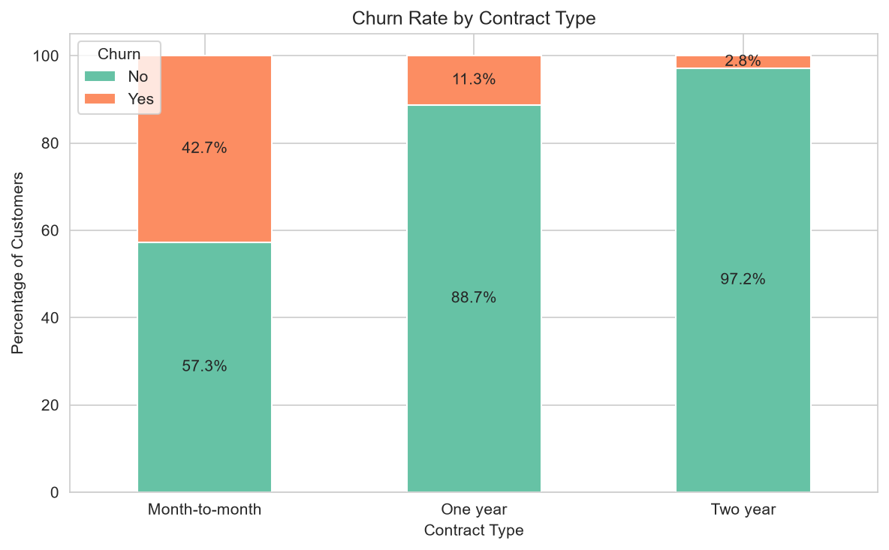
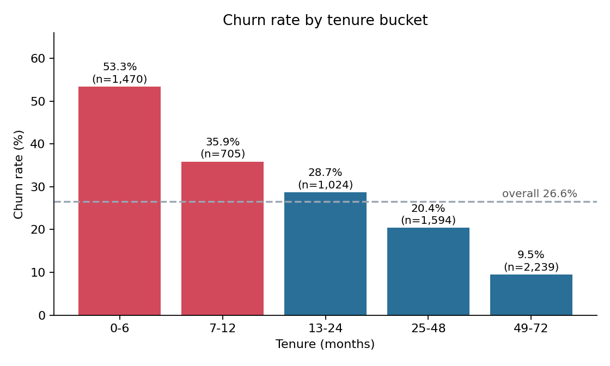
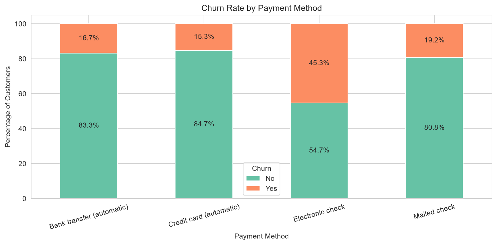
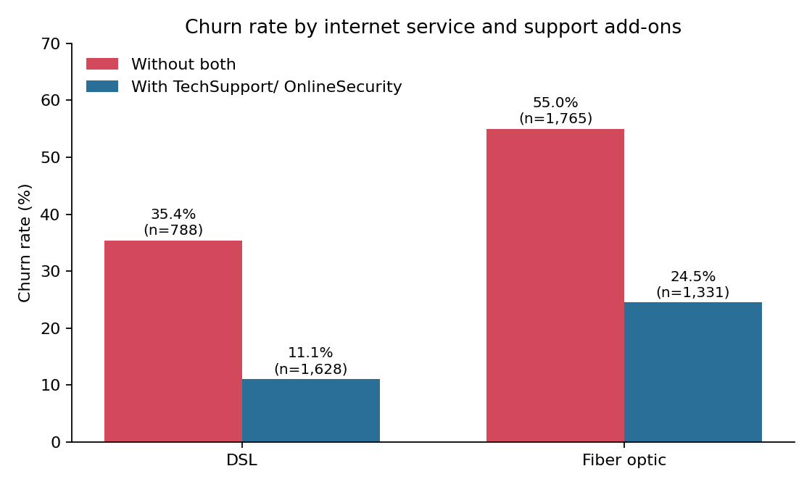
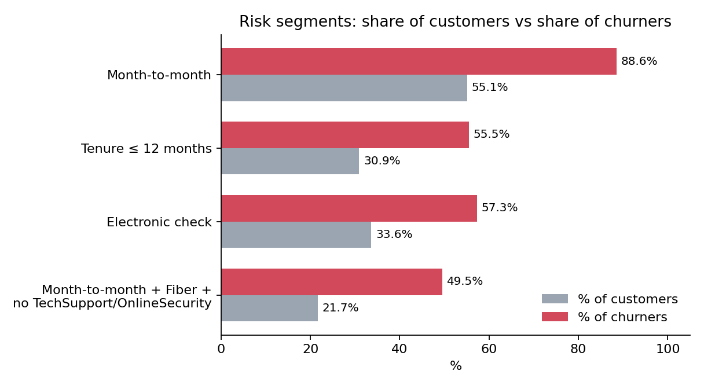

# Reducing Customer Churn Through Business-Focused Data Analysis

Exploratory analysis of 7,032 telecom customers to find who is leaving, why the pattern matters financially, and which segment a retention campaign should target first.

## Executive Summary

- **26.6% of customers churned** (1,869 of 7,032). Churners pay more than average, so they account for **30.5% of monthly recurring revenue** (about $139K of $456K per month, roughly **$1.67M per year** if annualized).
- **Month-to-month customers are 55% of the base but 89% of all churners** (42.7% churn vs 11.3% for one-year and 2.8% for two-year contracts).
- **Churn is front-loaded:** customers in their first 12 months are 31% of the base but 56% of churners. Churn falls from 53.3% (0-6 months) to 9.5% (49+ months).
- **The best campaign target is month-to-month + Fiber optic + no TechSupport/OnlineSecurity**: 21.7% of customers, **60.7% churn rate, 49.5% of all churners, 56.3% of lost revenue**.
- **Higher monthly charges are not a driver on their own.** The price effect is largely explained by Fiber optic customers without support add-ons (see Insight 4).

> This is a descriptive analysis. Findings are associations in a single snapshot, not proven causes.

## Business Problem

Customer churn reduces recurring revenue and raises acquisition costs. Retention budgets are limited, so the question is not only *who* churns but *which group is worth targeting first*.

**Questions:** Which customers churn most? Which factors matter most? How big is the revenue at stake? Which segment should a retention campaign prioritize?

## Dataset

- **Source:** [IBM Telco Customer Churn (Kaggle)](https://www.kaggle.com/datasets/blastchar/telco-customer-churn)
- **Records:** 7,043 customers, 21 variables; 7,032 after cleaning
- **Cleaning:** 11 rows had blank `TotalCharges`. All had `tenure = 0` (customers who had just joined), so they were removed (0.16% of data). No duplicates found.
- **Churn rate:** 26.5% on raw data (7,043), 26.6% after cleaning (7,032). All figures below use the cleaned data.

## Tools

Python, Pandas, NumPy, Matplotlib, Seaborn, SciPy (chi-square / Cramér's V), Jupyter Notebook

## Key Insights

### 1. Contract type is the strongest factor

| Contract | Customers | Churn rate |
|---|---|---|
| Month-to-month | 3,875 | **42.7%** |
| One year | 1,472 | 11.3% |
| Two year | 1,685 | 2.8% |

Month-to-month is 55.1% of customers but 88.6% of churners.



### 2. Churn is concentrated in the first year

| Tenure (months) | Customers | Churn rate |
|---|---|---|
| 0-6 | 1,470 | **53.3%** |
| 7-12 | 705 | 35.9% |
| 13-24 | 1,024 | 28.7% |
| 25-48 | 1,594 | 20.4% |
| 49-72 | 2,239 | 9.5% |

Median tenure is 10 months for churners vs 38 for customers who stayed. 92% of first-year customers are on month-to-month contracts.



### 3. Electronic check customers churn most, even within the same contract type

Electronic check: **45.3% churn** vs 15-19% for other methods; 33.6% of customers but 57.3% of churners. The gap holds inside month-to-month contracts (53.7% for electronic check vs 32-34% for other methods), so it is not just a contract effect.



### 4. Fiber optic without support add-ons is the real hotspot

| Internet service | With TechSupport or OnlineSecurity | Customers | Churn rate |
|---|---|---|---|
| DSL | No | 788 | 35.4% |
| DSL | Yes | 1,628 | 11.1% |
| Fiber optic | No | 1,765 | **55.0%** |
| Fiber optic | Yes | 1,331 | 24.5% |

Add-ons are associated with much lower churn in both services. Churners do pay more on average ($74.4 vs $61.3 per month), but inside DSL the highest-priced band (> $70) churns *less* (6.7%) than the lowest (36.4%). Price alone is therefore a poor explanation; what customers bundle and which service they use matters more.



### 5. Factor ranking (Cramér's V with churn)

| Factor | Cramér's V |
|---|---|
| Contract | 0.41 |
| OnlineSecurity | 0.35 |
| TechSupport | 0.34 |
| InternetService | 0.32 |
| PaymentMethod | 0.30 |
| *Gender, PhoneService* | *< 0.02 (no relationship)* |

Note: the add-on columns include a "No internet service" group with low churn (7.4%), which inflates their scores somewhat.

## Priority Retention Segment

| Segment | Customers | Churn rate | Share of churners | Share of lost revenue |
|---|---|---|---|---|
| New (≤12 mo) + month-to-month + high charge + e-check + no add-ons (5 factors) | 457 (6.5%) | 75.5% | 18.5% | 20.9% |
| New (≤12 mo) + month-to-month + no add-ons | 1,188 (16.9%) | 64.5% | 41.0% | 39.1% |
| **Month-to-month + Fiber + no add-ons** | **1,524 (21.7%)** | **60.7%** | **49.5%** | **56.3%** |

Stacking all five risk factors gives the highest churn rate but is too narrow: it catches under one in five churners. A broader rule is easier to act on and captures about half of churn.



## Retention Recommendations

| # | Action | Target | Why |
|---|---|---|---|
| 1 | Bundle TechSupport + OnlineSecurity free for 3 months, then discounted | Month-to-month Fiber customers without add-ons | Add-ons associated with 55.0% → 24.5% churn in this group |
| 2 | Onboarding check-ins and early-life offers | First 12 months | 56% of churners leave in year one |
| 3 | Discount for switching to 12-month contract | Month-to-month, tenure 6+ months | 42.7% vs 11.3% churn |
| 4 | Incentive for auto-pay | Electronic check customers | 45.3% churn vs 15-19% elsewhere |

**Illustrative impact (assumption, not a forecast):** if actions reduce churn in the "new + month-to-month + no add-ons" segment (1,188 customers) by 10 percentage points (64.5% → 54.5%), about 119 customers are retained, worth roughly **$97K per year** in monthly charges; a 20-point reduction is about **$194K per year**. This ignores campaign cost, so the net benefit depends on cost per retained customer.

## Limitations

- Observational, single snapshot: no causal claims, and no information on *why* customers left.
- No cost data (acquisition, campaign cost, margin), so revenue figures are billing amounts, not profit.
- Many variables are correlated (for example, Fiber optic and higher price), so single-factor views can overstate individual effects.
- IBM sample dataset; patterns may not transfer to a real operator.

## Next Steps

- Build a predictive churn model (see my ML churn project: *link*).
- Publish an interactive dashboard of these segments (Tableau Public).

## Repository Structure

```
├── data/telco_churn.csv
├── notebooks/customer_churn_analysis.ipynb
├── images/
├── requirements.txt
└── README.md
```

## How to Run

```bash
git clone https://github.com/arwendy123/reducing-customer-churn-business-analysis.git
cd reducing-customer-churn-business-analysis
pip install -r requirements.txt
jupyter notebook notebooks/customer_churn_analysis.ipynb
```

Python 3.10+ recommended. Run all cells in order.